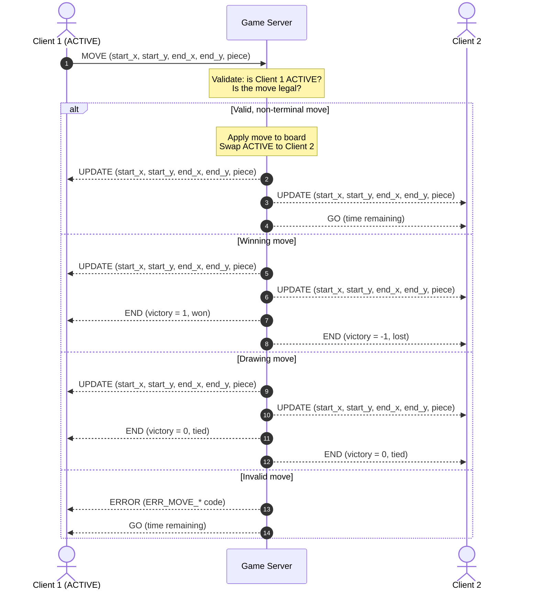

# CS 457 Project Statement of Work (SOW) & Protocol Specification

**Student Name:** Alexander Stanton  
**Date:** 2026-09-18  
**Course:** CS 457 - Computer Networks  
**Target Server Domain:** `server.stanton.edu`  

---

## 1. Game Selection & Scope (Sprint 0)

> Planning is going to be an iterative process through the sprints so you don't have to have all the details now. Focus on big overview concepts. You will be updating the SOW as we plan.
> You have a lot of freedom to choose a game. There are a couple caveats.  

> - It must run in the console. The lab nodes won't be able to handle extensive graphics.
> - It has to be self-contained. You can use a internet-connector to download you code, but because the architecture must run 5 nodes you won't be able to run 
> - You are encouraged to use python, but I'm not going to make it a strict requirement. The instructor and TA's ability to help with C or Rust, etc will be diminished in other languages.

### 1.1 Game Overview

- **Chosen Game:** Fairy Chess (console)
- **Player Capacity:** 2 Players (Simulated via 2 CML Client nodes)
- **Game Summary:** The project will implement a two-player console-based chess engine beginning with the standard rules of chess. The architecture will be designed to support additional chess variants and fairy-chess scenarios without requiring substantial changes to the underlying game-management system.

  Starting with normal chess (https://en.wikipedia.org/wiki/Rules_of_chess), I will expand to additional scenarios and pieces as time affords. Basic chess with an extensible engine may be sufficient, depending on complexity. Games are timed: each player has a clock, ten minutes by default (not yet configurable).

### 1.2 Core Game Rules & Win/Draw Conditions

- **Turn Mechanics:** The game is strictly turn-based. Players alternate between active and inactive, starting with the White side of the board. The inactive player will not receive a prompt to act until their turn begins, and all move requests from the inactive player will be dropped. Alternation occurs after the active player submits their move.
- **Victory Condition:** Fulfill the scenario's victory condition. For normal chess, victory occurs through a checkmate, the opponent running out time, or the opponent forfeiting.
- **Clocks:** The server keeps each player's remaining time in whole seconds, starting at ten minutes. A player's clock runs only while they are active, and every turn costs at least one second. Each `GO` tells the player how much time they have left. A player whose clock reaches zero loses, even if the opponent couldn't checkmate (this may be refined later). Clocks have one-second granularity, so network delay is ignored. Clients accept any nonzero time, so other limits can be used later without changing them.
- **Draw/Tie Condition:** For normal chess, ties occur if:
  - the active player has no valid moves and is not in check
  - the board reaches a dead position, from which neither player can legally check the other (for now, only the standard insufficient-material cases are detected; this may be expanded later)
  - both players agree to a draw: either player may send `DRAW` at any time, naming the current turn. The server forwards it to the opponent as an offer, and once both players have sent `DRAW` for the same turn the game ends tied. An offer lapses when the turn ends, and a `DRAW` naming any other turn is dropped.
  - a client rejects the starting layout (see Board Layouts): the game ends without a winner
- **Board Layouts:** The server describes the board size and starting position in `START`, so the board can be any size up to 255 × 255 with up to 78 pieces. The server currently sends only the standard chess position, but clients accept any valid layout. On other boards, the standard rules are generalized as follows (they behave exactly as normal on the standard board):
  - White moves toward increasing rows and moves first.
  - A pawn that has never moved may move two squares forward, from any row. En passant applies after any double step.
  - A pawn promotes on reaching the far row, including by a double step.
  - Castling needs the king and a rook to be unmoved, on the same row, at least three squares apart, with only empty squares between them. The king moves two squares toward the rook, and the rook lands on the square the king passed over. The king may not be in check, pass through an attacked square, or land on one. A castle is sent as the king's two-square move alone, and the receiver moves the rook.
- **Colours:** The server picks at random which player moves first. That player plays white, and `START` tells each client its colour.
- **Score Summary:** At the end of the game each player sees whether they won, lost or tied, and their material points: the value of the opponent's pieces they captured (pawn 1, knight 3, bishop 3, rook 5, queen 9). Points never decide the result.
- **Leaving:** A player who leaves a game in progress, for any reason, forfeits it.

### 1.3 Command-Line Interface & Display

Both programs are C binaries built with `make`.

| Command | Meaning |
|:--------|:--------|
| `./server -h` | Print usage and exit |
| `./server -p 8080` | Listen on port 8080 on all interfaces (`0.0.0.0`) |
| `./client -h` | Print usage and exit |
| `./client -i server.stanton.edu -p 8080` | Resolve the server's hostname and connect to it on port 8080 |

- **Arguments:** `-p` is required by both programs, and `-i` by the client. A missing, repeated, unknown or malformed argument (for example, a port outside 1–65535) is rejected: the program names the problem, prints the usage, and exits with status 1.
- **DNS failure:** The client resolves the hostname with `getaddrinfo()`. If that fails, including when the DNS server is unreachable, it prints a clear message with the `gai_strerror()` text, advises checking the router's DNS configuration (`ip dns server` / `ip host`) and the spelling of the name, and exits with status 1. It never crashes.
- **Display:** The client draws the board from its own side after every move, and shows its status ("Waiting for Player 2...", "Your turn", "Opponent's turn"), the remaining time from each `GO`, both players' material points, draw offers, and errors. At the end it shows the result and the score summary.
- **Commands:** At the prompt the user types a move (`e2e4`, `e7e8q` to promote, `e1g1` to castle), `draw` to offer or accept a draw, or `quit` to leave the game (a forfeit).
- **Interrupts:** The server ignores Ctrl-C (`SIGINT`) until the current game completes, then exits at `CLEANUP`. If the server is stopped any other way, its clients find out through the keepalive timeout. Ctrl-C in the client is the same as `quit`.

---

## 2. Application-Layer Messaging Protocol Blueprint (Sprint 1 Deliverable)

### 2.1 Message Transport & Serialization Format

- **Transport Protocol:** TCP
- **Implementation Language:** C
- **Serialization Format:** Custom fixed-header binary schema. Every field is built from single octets (`u8`, or `i8` for signed values), so byte order never matters. Structures are packed with no padding.
- **Framing Mechanism:** A 1-byte type header followed by a fixed-size payload. Each message type has a predetermined payload size, looked up from the type in `PAYLOAD_SIZE[]`. The one exception is `START`, which is variable-sized (at most 255 bytes of payload). Messages are read in up to three stages:
  1. Read the 1-byte header from the TCP stream to identify the message type.
  2. Look up the payload length for that type and read exactly that many bytes.
  3. For `START` only, read the `count × 3` bytes of placements that follow its fixed 20-byte prefix (`payload_extra()`).

  On a partial read, the reader keeps reading until the whole message has arrived. If the message isn't complete within ten seconds of its first byte, the connection is considered dead. Several messages may be queued in the stream, but they're read out one at a time.

- **Timing:** Each peer sends `KEEPALIVE` every second, and considers the other dead after a minute of silence. A partial message must complete within ten seconds, and threads wake at least every 50 ms. These values are named constants in `shared/timing.h`, kept together for tuning.

Each device keeps its own copy of the game state locally. Only changes to the state are sent, and the server verifies every change.

See `protocol_blueprint.md` for the full C definitions.

### 2.2 Message Schema Definitions

#### Message Types:

| # | Type         | Direction        | Payload                                         | Purpose |
|:-:|:------------:|:----------------:|:------------------------------------------------|:--------|
| 0 | `KEEPALIVE`  | bidirectional    | *(none)*                                        | Periodic signal confirming the connection is live |
| 1 | `ERROR`      | bidirectional    | `u8 code` (see Error Codes below)               | Invalid move, invalid layout or unexpected message |
| 2 | `CONNECT`    | client -> server | `u8 id[16]` (1-15 printable ASCII characters, NUL-terminated) | Request to join a game under `id` |
| 3 | `ACCEPT`     | server -> client | *(none)*                                        | Server accepts the connection request |
| 4 | `START`      | server -> client | `u8 id[16]` (opponent ID), `u8 color` (receiver's colour), `u8 cols, rows, count`, then `count` × `u8 piece, row, col` | Gameplay is beginning, on the given board (sent to both clients) |
| 5 | `GO`         | server -> client | `u8 time[2]` (remaining seconds, most significant byte first) | The receiving client's turn is beginning |
| 6 | `MOVE`       | client -> server | `u8 start_x, start_y, end_x, end_y, piece`      | Client submits a requested move |
| 7 | `UPDATE`     | server -> client | `u8 start_x, start_y, end_x, end_y, piece`      | Server broadcasts an approved move to both clients |
| 8 | `END`        | server -> client | `i8 victory` (enum: won `1`, lost `-1`, tied `0`), `u8 points[2]` (receiver's material points, most significant byte first) | Game has concluded; whether the receiver won, lost, or tied, and its score |
| 9 | `DISCONNECT` | bidirectional    | *(none)*                                        | Intentional termination of the connection |
| 10 | `DRAW`      | bidirectional    | `u8 turn[2]` (turn number, most significant byte first) | Client offers or accepts a draw for that turn; server forwards an offer to the opponent |

Intentional and unintentional disconnects by a client during a game count as a forfeit.

#### Example Binary Messages:

`CONNECT` for player "Xavier" (1-byte header + 16-byte NUL-padded ID):
```
|MSG_CONNECT|'X'|'a'|'v'|'i'|'e'|'r'|0|0|0|0|0|0|0|0|0|0|
```

`ACCEPT` (header only):
```
|MSG_ACCEPT|
```

`START` for the standard position, to a player who plays white against opponent "Bob" (1-byte header + 20-byte prefix + 32 placements of 3 bytes):
```
|MSG_START|'B'|'o'|'b'|0|0|0|0|0|0|0|0|0|0|0|0|0|WHITE|8|8|32|ROOK|0|0|KNIGHT|0|1| ... |KING+0x80|7|4| ... |
```

Each placement is the piece type with the high bit (`0x80`) set for black, then its row and column (0-indexed, the same axes as `MOVE`'s `y` and `x`).

`END` to a winner with 13 points (1-byte header + 1-byte result + 2-byte points):
```
|MSG_END|1|0x00|0x0D|
```

`GO` with the full ten minutes, 600 seconds = `0x0258` (1-byte header + 2-byte time):
```
|MSG_GO|0x02|0x58|
```

`DRAW` offered on turn 12, after twelve moves (1-byte header + 2-byte turn):
```
|MSG_DRAW|0x00|0x0C|
```

Turns are numbered from 0 at `START` and advance with every `UPDATE`, modulo 65,536.

`MOVE` from e2 to e4, using 0-indexed coordinates and the moving piece's type (1-byte header + 5 bytes):
```
|MSG_MOVE|4|1|4|3|PAWN|
```

`piece` is the type of the piece on the end square after the move. It equals the moving piece's type, except on a promotion, where it names the new piece (queen, rook, bishop or knight). Piece type values are `PAWN` = 1, `KNIGHT` = 2, `BISHOP` = 3, `ROOK` = 4, `QUEEN` = 5, `KING` = 6. `0` is never valid.

A castle is sent as one `MOVE` of the king two squares toward the rook, with `piece` = `KING`; for example, white's kingside castle is `|MSG_MOVE|4|0|6|0|KING|`. A king can't move two squares any other way, so this is never ambiguous. The rook isn't sent: the server and both clients move it themselves when they apply the move.

#### Error Codes:

Codes are grouped into families by their high nibble. `0x00`–`0x0F` is reserved.

| Family   | Code   | Name                     | Meaning |
|:---------|:------:|:-------------------------|:--------|
| Protocol | `0x10` | `ERR_UNEXPECTED_MESSAGE` | Message not valid in the receiver's current state |
|          | `0x11` | `ERR_NOT_YOUR_TURN`      | `MOVE` from the inactive player |
|          | `0x12` | `ERR_SERVER_FULL`        | Connection refused: both player slots are taken |
|          | `0x13` | `ERR_BAD_PLAYER_ID`      | `CONNECT` ID is empty, has no NUL terminator, or isn't printable ASCII |
|          | `0x14` | `ERR_UNKNOWN_TYPE`       | Header type byte is not a known message type (fatal) |
|          | `0x15` | `ERR_DUPLICATE_PLAYER_ID` | `CONNECT` carried the other player's ID |
|          | `0x16` | `ERR_ZERO_TIME`          | `GO` carried a remaining time of 0 |
| Move     | `0x20` | `ERR_MOVE_BOUNDS`        | A coordinate is off the board |
|          | `0x21` | `ERR_MOVE_NOT_OWN`       | Start square is empty or holds the opponent's piece |
|          | `0x22` | `ERR_MOVE_PATTERN`       | The piece cannot move that way |
|          | `0x23` | `ERR_MOVE_SELF_CHECK`    | The move would leave the mover's king in check |
|          | `0x24` | `ERR_MOVE_GAME_OVER`     | The game has already ended |
|          | `0x25` | `ERR_MOVE_PIECE_TYPE`    | `piece` doesn't match the mover, or isn't a valid promotion |
| Configuration | `0x30` | `ERR_CONFIG_NO_KING` | `START` layout gives a side no king |
|          | `0x31` | `ERR_CONFIG_SIZE`        | `START` layout has zero columns or rows |
|          | `0x32` | `ERR_CONFIG_COUNT`       | `START` layout has more than 78 placements |
|          | `0x33` | `ERR_CONFIG_PIECE_TYPE`  | `START` placement has an unknown piece type |
|          | `0x34` | `ERR_CONFIG_PLACEMENT`   | `START` placement is off the board or on an occupied square |
|          | `0x35` | `ERR_CONFIG_MULTIPLE_KINGS` | `START` layout gives a side more than one king |
|          | `0x36` | `ERR_CONFIG_PAWN_PROMOTION` | `START` layout has a pawn on its promotion row |
|          | `0x37` | `ERR_CONFIG_FINISHED`    | `START` position is already checkmate, stalemate or dead |
|          | `0x38` | `ERR_CONFIG_IN_CHECK`    | `START` position has a side in check |
|          | `0x39` | `ERR_CONFIG_COLOR`       | `START` colour is neither white nor black |
| Update   | `0x40` | `ERR_UPDATE_BAD_STATE`   | The client's engine rejected an `UPDATE`, so its board differs from the server's |

`ERR_UNKNOWN_TYPE`, the Configuration family and the Update family are fatal: the sender follows the `ERROR` with `DISCONNECT` and closes the connection.

---

### 2.3 Game State Machine (FSM) Design (Sprint 1 Deliverable)

See `fsm_specification.md` for the full transition rules and state diagrams.

- **Server State Flow:** `WAIT_P1` -> `WAIT_P2` -> `INIT` -> `TURN` <-> `CLASSIFY` -> `FINISH` -> `CLEANUP` -> (`WAIT_P1` or exit)
  - `WAIT_P1`: On `CONNECT` with a valid ID, assign the client as `C1`, reply `ACCEPT`, and go to `WAIT_P2`. An ID that is empty, has no NUL terminator, or contains anything but printable ASCII gets `ERROR` (`ERR_BAD_PLAYER_ID`), and the connection stays open so the client can try again until its keepalive timeout. Ignore `KEEPALIVE`, since no client is assigned yet.
  - `WAIT_P2`: Send keepalives to `C1`. On a valid `CONNECT` from a different client, assign it as `C2`, reply `ACCEPT`, and go to `INIT`. An invalid ID gets `ERR_BAD_PLAYER_ID`, and `C1`'s ID gets `ERR_DUPLICATE_PLAYER_ID`; the client may try again. If `C1` disconnects, times out, hits EOF or gets a TCP error, clear `C1` and go back to `WAIT_P1`.
  - `INIT`: Initialize the game state with the standard layout, pick `ACTIVE` at random to play white, set both clocks to ten minutes, send `START` (opponent ID, the receiver's colour and the layout) to both clients, send `GO` (with its remaining time) to `ACTIVE`, and go to `TURN`.
  - `TURN`: Send keepalives to both clients, and reset a client's keepalive timer when its `KEEPALIVE` arrives. A `MOVE` from `ACTIVE` goes to `CLASSIFY`. A `MOVE` from the inactive player gets `ERROR` (`ERR_NOT_YOUR_TURN`), and any other message gets `ERROR` (`ERR_UNEXPECTED_MESSAGE`). A `DRAW` for the current turn from one client is forwarded to the other as an offer; once both clients have sent `DRAW` for the same turn, the game is tied and the server goes to `FINISH`. A `DRAW` for any other turn is dropped. A Configuration-family `ERROR` from either client also ties the game. If `ACTIVE`'s clock runs out, or either client disconnects, its opponent wins and the server goes to `FINISH`.
  - `CLASSIFY`: An invalid move gets `ERROR` sent to `ACTIVE` with the matching Move-family code, followed by another `GO` with its remaining time so the player can retry (its clock keeps running), and returns to `TURN`. A winning or drawing move is sent as an `UPDATE` to both clients so they see the final position. Then `ACTIVE` is marked the winner, or the game is marked tied, and the server goes to `FINISH`. Otherwise, charge `ACTIVE` for the turn (at least one second), send `UPDATE` to both clients, advance the turn number (dropping any draw offers), and swap `ACTIVE`. If the new `ACTIVE` has no time left, the other player wins and the server goes to `FINISH`; otherwise send `GO` with its remaining time and return to `TURN`.
  - `FINISH`: Send `END` to each connected client, with `victory` from that client's perspective (the winner gets won (`1`), the loser gets lost (`-1`), and on a tie both get tied (`0`)) and that client's material points.
  - `CLEANUP`: Send `DISCONNECT` to each connected client. Then exit if Ctrl-C was pressed during the game, or return to `WAIT_P1` otherwise.
  - Outside `TURN`, the server ignores `DRAW`.
  - In any state, a message with an unknown type gets `ERROR` (`ERR_UNKNOWN_TYPE`) and `DISCONNECT`, and the server closes that connection. It is then handled like any other disconnect.
  - When both player slots are taken, the main thread sends any extra connection `ERROR` (`ERR_SERVER_FULL`) and `DISCONNECT` and closes it. Beyond three simultaneous connections, it may drop them without a message.
- **Client State Flow:** `ENTER` -> `PAIR` -> `WAIT` -> `TURN` -> `FINISH` -> exit
  - `ENTER`: Resolve the server's hostname and connect, exiting with a clear message and status 1 if either fails. Send `CONNECT` and go to `PAIR`.
  - `PAIR`: Exchange keepalives with the server. On `ACCEPT`, initialize the game state and go to `WAIT`. On `ERR_BAD_PLAYER_ID` or `ERR_DUPLICATE_PLAYER_ID`, ask the user for another ID and send `CONNECT` again. On `DISCONNECT`, keepalive timeout, EOF or TCP error, exit.
  - `WAIT`: Exchange keepalives with the server. On `START`, set up the board from its layout and go to `TURN`. If the layout is invalid, send `ERROR` with the matching Configuration-family code (`ERR_CONFIG_*`), send `DISCONNECT`, and exit. On `END`, go to `FINISH`.
  - `TURN`: On `GO`, show the remaining time, prompt the user and send `MOVE`; a `GO` with zero time instead gets `ERROR` (`ERR_ZERO_TIME`) and no prompt. On `UPDATE`, apply the move to the local board and advance the turn number; if the local engine rejects it, send `ERROR` (`ERR_UPDATE_BAD_STATE`), send `DISCONNECT`, and exit. On `DRAW` for the current turn, show the user the opponent's draw offer; drop a `DRAW` for any other turn. On `ERROR`, warn the user. On `END`, go to `FINISH`. Whenever the user asks for a draw, send `DRAW` with the current turn number; this doesn't use up the user's turn.
  - In any state, a message with an unknown type gets `ERROR` (`ERR_UNKNOWN_TYPE`) and `DISCONNECT`, and the client exits.
  - In `PAIR` and `WAIT`, the client ignores `DRAW`.
  - In any state, when the user types `quit` or presses Ctrl-C, send `DISCONNECT` and exit. During a game this is a forfeit.
  - `FINISH`: Display the result (won, lost, or tied) and the score summary, send `DISCONNECT`, and exit.
- **Error Handling:** `DRAW` may be sent at any time, so it never gets `ERR_UNEXPECTED_MESSAGE`. A peer never responds to an `ERROR` with an `ERROR`. The server ignores a received `ERROR`, except that a Configuration-family `ERROR` during gameplay ties the game. The client warns the user. Fatal errors (`ERR_UNKNOWN_TYPE`, Configuration, Update) are always followed by `DISCONNECT`. This prevents two peers from exchanging `ERROR` messages indefinitely.
- **Disconnect Handling:** Graceful disconnects (`DISCONNECT`) and abrupt ones (keepalive timeout, EOF, socket error) go through the same FSM logic. In C, `recv` returning zero or a negative value is treated as a connection termination. If a client loses the server, the client tells the user and exits with status 1. If the server loses a client, it recovers while still waiting for players, and counts it as a forfeit during gameplay.

---

## 3. Game Behavior & Server Concurrency Architecture (Sprint 2 Deliverable)

See `concurrency_design.md` for full details.

### 3.1 Server Concurrency Strategy

- **Architecture Choice:** Multi-threading with POSIX threads. Each connected client socket gets its own worker thread. Once both players have joined, the main thread rejects further connections, so at most three threads run at once: the main thread and two client workers. The main thread accepts connections and drives the match lifecycle. Each worker performs all socket I/O for its own client, including keepalives and detecting disconnects.
- **Synchronization Logic:** Access to the shared game state (board, active player, clocks, result) is controlled by one atomic ownership variable. It can hold one of three values:

  | Owner value | Exclusive owner | Permitted operations |
  |:-----------:|:---------------:|:---------------------|
  | `MAIN`      | Main thread     | Initialize, admit connections, handle lifecycle transitions, finalize the game |
  | `CLIENT_1`  | Client 1 worker | Validate and apply client 1's accepted game action |
  | `CLIENT_2`  | Client 2 worker | Validate and apply client 2's accepted game action |

  Each thread keeps a thread-local copy of its own owner value. It may read or write shared state only while the ownership variable equals that value, and it may only hand ownership from its own value to another thread's. The ownership variable is stored with release semantics and loaded with acquire semantics, so changes made by the previous owner are visible to the next one. This keeps the invariant that exactly one thread can access the shared game state at a time. A worker hands ownership to the opponent's worker after a valid, non-terminal move, and to `MAIN` after a winning or drawing move or a disconnect.
- **Client Liveness:** Each client slot has an atomic liveness state (`SLOT_EMPTY`, `SLOT_CONNECTED`, `SLOT_JOINED`, `SLOT_DEAD`) that any thread may read without owning the game state. While a worker runs, only that worker writes its slot's liveness. When its client disconnects, times out, or fails, the worker marks the slot `SLOT_DEAD`. If that worker owns the game state, it hands ownership to `MAIN` with the opponent as winner. Otherwise, the owning worker sees the dead slot on its next wake-up (within one short `poll()` timeout) and hands ownership to `MAIN` with itself as winner. A dead worker keeps running until the main thread tells it to exit, so ownership is never handed to a thread that has exited.
- **Single-Writer Rule:** Each client socket is written only by that client's worker, so outgoing messages can never interleave on the wire. A worker sends `KEEPALIVE`, `ACCEPT`, `ERROR`, the `UPDATE` for its own client's move, a retry `GO`, and the `DISCONNECT` after a fatal `ERR_UNKNOWN_TYPE` directly. A connection refused because the server is full has no worker; the main thread is its only writer. Every other message goes through the client's outbox: `START`, `END` and `DISCONNECT` from the main thread, and the opponent's `UPDATE`, next `GO` and draw offer (`DRAW`) from the opponent's worker. A worker fills in its own client's `GO` time when it sends the `GO`. A sender writes the payload, then sets an atomic pending flag with release ordering. The worker takes all flags at once with an acquire exchange and sends them in a fixed order (`START`, `UPDATE`, `GO`, `DRAW`, `END`, `DISCONNECT`).
- **Draw Offers & Clocks:** The current turn number and each player's draw offer for it share one atomic word, which either worker may update without owning the game state. A worker that receives `DRAW` sets its own bit only if the offer's turn matches the word's turn, and otherwise drops it. If the opponent's bit wasn't already set, it forwards the offer through the opponent's outbox. When both bits are set, the owning worker records a tie and hands ownership to `MAIN`, just as it handles an opponent's disconnect. After a valid move, the owner replaces the word with the next turn and no offers. A Configuration-family `ERROR` sets a separate atomic flag, which the owner turns into a tie the same way. The clocks are part of the owned game state. The active player's worker starts its clock when it sends `GO`, checks it on every wake-up, and hands ownership to `MAIN` with the opponent as winner if it runs out.

### 3.2 State & Score Synchronization Across Clients

- **Turn Enforcement:** The server tracks the `ACTIVE` player and accepts `MOVE` only from that client. A worker thread processes a move only while it owns the shared state. A `MOVE` from the inactive player gets an `ERROR` reply with `ERR_NOT_YOUR_TURN`, and any other unexpected message gets `ERR_UNEXPECTED_MESSAGE`. After a valid move, the server swaps `ACTIVE` and sends `GO` to the new active player, which is the only signal that a turn has begun. Ownership is handed to the new active player's worker before its `GO` is queued. As a result, by the time that client can reply with a `MOVE`, its worker already owns the game state.
- **Score & Board Synchronization:** Each client keeps a full local copy of the board. The server sends the whole board only once, as the starting layout in `START`. After that, it sends an `UPDATE` with the approved move's start and end coordinates to both clients, and each client applies it locally. Since the server validates every move before broadcasting it, and both clients apply the same moves in the same order, their boards stay identical. `END` tells each client whether it won, lost, or tied, and its material points. Each client also counts both players' points with its own engine as moves arrive, so it can show the score during the game.

#### Move Sequence (Player 1 moves):



---

## 4. Coding & AI Implementation Plan (Sprint 3)

- **Permitted AI Tools:** [e.g., GitHub Copilot, ChatGPT, Claude]
- **AI Prompting & Constraint Strategy:** Explain how you will constrain AI models to generate code (in C) that adheres strictly to the protocol blueprint and FSM designed in Sprints 1 & 2.
- **Implementation Risk Management:** Detail your plan to leverage past programming experience and manage time to ensure code completion on schedule.

---

## 5. CML Multi-Subnet Topology & Wireshark Deployment Plan (Sprint 4 & 5 Deliverable)

> For now you can use the topology below. We may update this when we get to defining subnets.

### 5.1 Subnet & Router Design

- **Subnet A (Client 1):** `192.168.10.0/24` (Interface `Gi0/1` on Router R1)
- **Subnet B (Client 2):** `192.168.11.0/24` (Interface `Gi0/2` on Router R1)
- **Subnet C (Game Server):** `192.168.20.0/24` (Interface `Gi0/1` on Router R2)
- **Router Backbone:** `10.0.0.0/30` (Interface `Gi0/0` on R1 <-> `Gi0/0` on R2)

### 5.2 DHCP Pools & DNS Configuration Plan

- **Router R1 DHCP Pool 1 (`CLIENT1_POOL`):** Leases `192.168.10.10` - `192.168.10.50`, gateway `192.168.10.1`, DNS `10.0.0.2`.
- **Router R1 DHCP Pool 2 (`CLIENT2_POOL`):** Leases `192.168.11.10` - `192.168.11.50`, gateway `192.168.11.1`, DNS `10.0.0.2`.
- **Router R2 Authoritative DNS:** Configured with `ip dns server` and static host mapping `server.stanton.edu` -> `192.168.20.100`.

### 5.3 Deployment Strategy & Wireshark Trace Capture

- **CML Deployment Strategy:** Build the `server` and `client` binaries with `make`. Run `./server -p <port>` on the Subnet C node (`192.168.20.100`) behind Router R2, and `./client -i server.stanton.edu -p <port>` on the Subnet A and Subnet B nodes behind Router R1.
- **Cisco Infrastructure Configuration:** Router R1 DHCP pools (`CLIENT1_POOL`, `CLIENT2_POOL`) and Router R2 authoritative DNS (`ip host server.stanton.edu 192.168.20.100`).
- **Wireshark Trace Capture Plan:** Capture DHCP DORA exchange (`dhcp_negotiation.pcap`) and DNS query/response resolution (`dns_lookup.pcap`).
