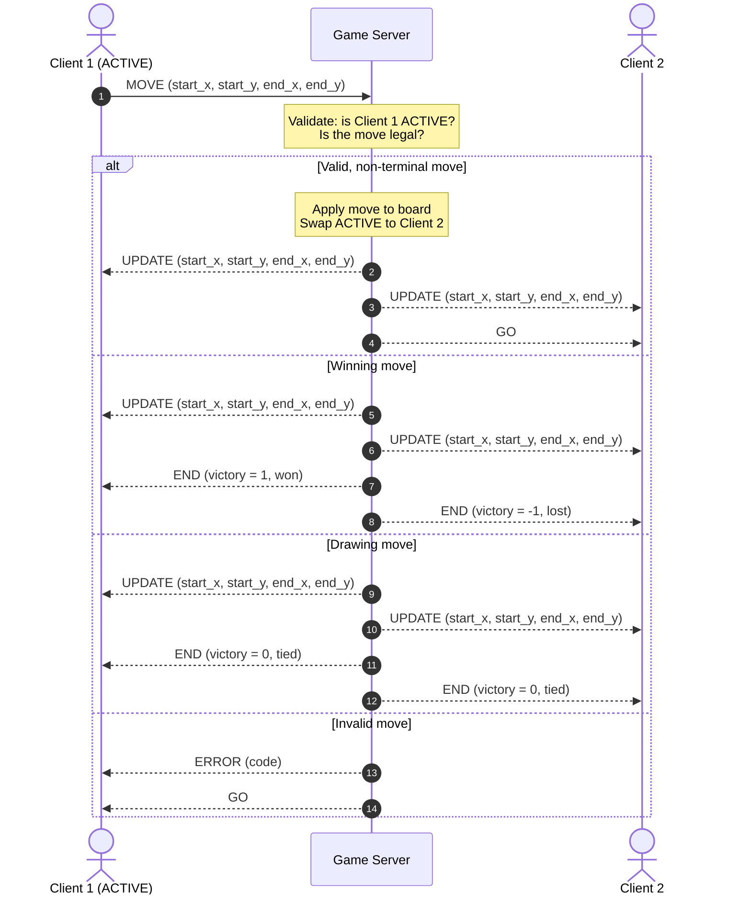

# CS 457 Project Statement of Work (SOW) & Protocol Specification

**Student Name:** Alexander Stanton  
**Date:** 2026-09-18  
**Course:** CS 457 - Computer Networks  
**Target Server Domain:** `server.stanton.edu`  

---

## 1. Game Selection & Scope (Sprint 0)

> Planning is going to be an iterative process through the sprints so you don't have to have all the details now. Focus on big overview concepts. You will be updating the SOW as we plan.
> You have a lot of freedom to choose a game. There are a couple caveats.  

> - It must run in the console. The lab nodes won't be able to handle extensive graphics.
> - It has to be self-contained. You can use a internet-connector to download you code, but because the architecture must run 5 nodes you won't be able to run 
> - You are encouraged to use python, but I'm not going to make it a strict requirement. The instructor and TA's ability to help with C or Rust, etc will be diminished in other languages.

### 1.1 Game Overview

- **Chosen Game:** Fairy Chess (console)
- **Player Capacity:** 2 Players (Simulated via 2 CML Client nodes)
- **Game Summary:** The project will implement a two-player console-based chess engine beginning with the standard rules of chess. The architecture will be designed to support additional chess variants and fairy-chess scenarios without requiring substantial changes to the underlying game-management system.

  Starting with normal chess (https://en.wikipedia.org/wiki/Rules_of_chess), I will expand to additional scenarios and pieces as time affords. Basic chess with an extensible engine may be sufficient, depending on complexity. Games will be timed with a configurable limit.

### 1.2 Core Game Rules & Win/Draw Conditions

- **Turn Mechanics:** The game is strictly turn-based. Players alternate between active and inactive, starting with the White side of the board. The inactive player will not receive a prompt to act until their turn begins, and all move requests from the inactive player will be dropped. Alternation occurs after the active player submits their move.
- **Victory Condition:** Fulfill the scenario's victory condition. For normal chess, victory occurs through a checkmate, the opponent running out time, or the opponent forfeiting.
- **Draw/Tie Condition:** For normal chess, ties occur if:
  - the active player has no valid moves and is not in check
  - the board reaches a dead position, from which neither player can legally check the other
  - both players agree to a draw

---

## 2. Application-Layer Messaging Protocol Blueprint (Sprint 1 Deliverable)

### 2.1 Message Transport & Serialization Format

- **Transport Protocol:** TCP
- **Implementation Language:** C
- **Serialization Format:** Custom fixed-header binary schema. Every field is built from single octets (`u8`, or `i8` for signed values), so byte order never matters. Structures are packed with no padding.
- **Framing Mechanism:** A 1-byte type header followed by a fixed-size payload. Each message type has a predetermined payload size, looked up from the type in `PAYLOAD_SIZE[]`. Messages are read in two stages:
  1. Read the 1-byte header from the TCP stream to identify the message type.
  2. Look up the payload length for that type and read exactly that many bytes.

  On a partial read, the reader keeps reading until the whole message has arrived. If the message isn't complete before the timeout expires, the connection is considered dead. Several messages may be queued in the stream, but they're read out one at a time.

Each device keeps its own copy of the game state locally. Only changes to the state are sent, and the server verifies every change.

See `protocol_blueprint.md` for the full C definitions.

### 2.2 Message Schema Definitions

#### Message Types:

| # | Type         | Direction        | Payload                                         | Purpose |
|:-:|:------------:|:----------------:|:------------------------------------------------|:--------|
| 0 | `KEEPALIVE`  | bidirectional    | *(none)*                                        | Periodic signal confirming the connection is live |
| 1 | `ERROR`      | bidirectional    | `u8 code`                                       | Invalid move or unexpected message |
| 2 | `CONNECT`    | client -> server | `u8 id[16]` (NUL-terminated player ID)          | Request to join a game under `id` |
| 3 | `ACCEPT`     | server -> client | *(none)*                                        | Server accepts the connection request |
| 4 | `START`      | server -> client | `u8 id[16]` (opponent ID), `u8 game` (board layout) | Gameplay is beginning (sent to both clients) |
| 5 | `GO`         | server -> client | *(none)*                                        | The receiving client's turn is beginning |
| 6 | `MOVE`       | client -> server | `u8 start_x, start_y, end_x, end_y`             | Client submits a requested move |
| 7 | `UPDATE`     | server -> client | `u8 start_x, start_y, end_x, end_y`             | Server broadcasts an approved move to both clients |
| 8 | `END`        | server -> client | `i8 victory` (enum: won `1`, lost `-1`, tied `0`) | Game has concluded; whether the receiver won, lost, or tied |
| 9 | `DISCONNECT` | bidirectional    | *(none)*                                        | Intentional termination of the connection |

Intentional and unintentional disconnects by a client during a game count as a forfeit.

#### Example Binary Messages:

`CONNECT` for player "Xavier" (1-byte header + 16-byte NUL-padded ID):
```
|MSG_CONNECT|'X'|'a'|'v'|'i'|'e'|'r'|0|0|0|0|0|0|0|0|0|0|
```

`ACCEPT` (header only):
```
|MSG_ACCEPT|
```

`MOVE` from e2 to e4, using 0-indexed coordinates (1-byte header + 4 bytes):
```
|MSG_MOVE|4|1|4|3|
```

---

### 2.3 Game State Machine (FSM) Design (Sprint 1 Deliverable)

See `fsm_specification.md` for the full transition rules and state diagrams.

- **Server State Flow:** `WAIT_P1` -> `WAIT_P2` -> `INIT` -> `TURN` <-> `CLASSIFY` -> `FINISH` -> `CLEANUP` -> (`WAIT_P1` or exit)
  - `WAIT_P1`: On `CONNECT`, assign the client as `C1`, reply `ACCEPT`, and go to `WAIT_P2`. Ignore `KEEPALIVE`, since no client is assigned yet.
  - `WAIT_P2`: Send keepalives to `C1`. On `CONNECT` from a different client, assign it as `C2`, reply `ACCEPT`, and go to `INIT`. If `C1` disconnects, times out, hits EOF or gets a TCP error, clear `C1` and go back to `WAIT_P1`.
  - `INIT`: Initialize the game state, pick `ACTIVE` at random, send `START` to both clients, send `GO` to `ACTIVE`, and go to `TURN`.
  - `TURN`: Send keepalives to both clients, and reset a client's keepalive timer when its `KEEPALIVE` arrives. A `MOVE` from `ACTIVE` goes to `CLASSIFY`. Any other message gets an `ERROR` reply. If either client disconnects, its opponent wins and the server goes to `FINISH`.
  - `CLASSIFY`: An invalid move gets `ERROR` sent to `ACTIVE`, followed by another `GO` so the player can retry, and returns to `TURN`. A winning or drawing move is sent as an `UPDATE` to both clients so they see the final position. Then `ACTIVE` is marked the winner, or the game is marked tied, and the server goes to `FINISH`. Otherwise, send `UPDATE` to both clients, swap `ACTIVE`, send `GO`, and return to `TURN`.
  - `FINISH`: Send `END` to each connected client, with `victory` from that client's perspective: the winner gets won (`1`), the loser gets lost (`-1`), and on a tie both get tied (`0`).
  - `CLEANUP`: Exit if shutting down. Otherwise send `DISCONNECT` to each connected client and return to `WAIT_P1`.
- **Client State Flow:** `ENTER` -> `PAIR` -> `WAIT` -> `TURN` -> `FINISH` -> exit
  - `ENTER`: Send `CONNECT` and go to `PAIR`.
  - `PAIR`: Exchange keepalives with the server. On `ACCEPT`, initialize the game state and go to `WAIT`. On `DISCONNECT`, keepalive timeout, EOF or TCP error, exit.
  - `WAIT`: Exchange keepalives with the server. On `START`, go to `TURN`. On `END`, go to `FINISH`.
  - `TURN`: On `GO`, prompt the user and send `MOVE`. On `UPDATE`, apply the move to the local board. On `ERROR`, warn the user. On `END`, go to `FINISH`.
  - `FINISH`: Display the result (won, lost, or tied), send `DISCONNECT`, and exit.
- **Error Handling:** A peer never responds to an `ERROR` with an `ERROR`. The server ignores a received `ERROR`, and the client warns the user. This prevents two peers from exchanging `ERROR` messages indefinitely.
- **Disconnect Handling:** Graceful disconnects (`DISCONNECT`) and abrupt ones (keepalive timeout, EOF, socket error) go through the same FSM logic. In C, `recv` returning zero or a negative value is treated as a connection termination. If a client loses the server, the client exits. If the server loses a client, it recovers while still waiting for players, and counts it as a forfeit during gameplay.

---

## 3. Game Behavior & Server Concurrency Architecture (Sprint 2 Deliverable)

See `concurrency_design.md` for full details.

### 3.1 Server Concurrency Strategy

- **Architecture Choice:** Multi-threading with POSIX threads. Each connected client socket gets its own worker thread. Once both players have joined, the main thread rejects further connections, so at most three threads run at once: the main thread and two client workers.
- **Synchronization Logic:** Access to shared state (game state, board grid, client sockets) is controlled by one atomic ownership variable. It can hold one of three values:

  | Owner value | Exclusive owner | Permitted operations |
  |:-----------:|:---------------:|:---------------------|
  | `MAIN`      | Main thread     | Initialize, admit connections, handle lifecycle transitions, finalize the game |
  | `CLIENT_1`  | Client 1 worker | Validate and apply client 1's accepted game action |
  | `CLIENT_2`  | Client 2 worker | Validate and apply client 2's accepted game action |

  Each thread keeps a thread-local copy of its own owner value. It may read or write shared state only while the ownership variable equals that value, and it may only hand ownership from its own value to another thread's. The ownership variable is stored with release semantics and loaded with acquire semantics, so changes made by the previous owner are visible to the next one. This keeps the invariant that exactly one thread can access the shared game state at a time.

### 3.2 State & Score Synchronization Across Clients

- **Turn Enforcement:** The server tracks the `ACTIVE` player and accepts `MOVE` only from that client. A worker thread processes a move only while it owns the shared state. A `MOVE` from the inactive player, or any other unexpected message, gets an `ERROR` reply. After a valid move, the server swaps `ACTIVE` and sends `GO` to the new active player, which is the only signal that a turn has begun.
- **Score & Board Synchronization:** Each client keeps a full local copy of the board. The server never sends the whole board. It sends an `UPDATE` with the approved move's start and end coordinates to both clients, and each client applies it locally. Since the server validates every move before broadcasting it, and both clients apply the same moves in the same order, their boards stay identical. `END` tells each client whether it won, lost, or tied.

#### Move Sequence (Player 1 moves):



---

## 4. Coding & AI Implementation Plan (Sprint 3)

- **Permitted AI Tools:** [e.g., GitHub Copilot, ChatGPT, Claude]
- **AI Prompting & Constraint Strategy:** Explain how you will constrain AI models to generate code (in Python or your chosen language) that adheres strictly to the protocol blueprint and FSM designed in Sprints 1 & 2.
- **Implementation Risk Management:** Detail your plan to leverage past programming experience and manage time to ensure code completion on schedule.

---

## 5. CML Multi-Subnet Topology & Wireshark Deployment Plan (Sprint 4 & 5 Deliverable)

> For now you can use the topology below. We may update this when we get to defining subnets.

### 5.1 Subnet & Router Design

- **Subnet A (Client 1):** `192.168.10.0/24` (Interface `Gi0/1` on Router R1)
- **Subnet B (Client 2):** `192.168.11.0/24` (Interface `Gi0/2` on Router R1)
- **Subnet C (Game Server):** `192.168.20.0/24` (Interface `Gi0/1` on Router R2)
- **Router Backbone:** `10.0.0.0/30` (Interface `Gi0/0` on R1 <-> `Gi0/0` on R2)

### 5.2 DHCP Pools & DNS Configuration Plan

- **Router R1 DHCP Pool 1 (`CLIENT1_POOL`):** Leases `192.168.10.10` - `192.168.10.50`, gateway `192.168.10.1`, DNS `10.0.0.2`.
- **Router R1 DHCP Pool 2 (`CLIENT2_POOL`):** Leases `192.168.11.10` - `192.168.11.50`, gateway `192.168.11.1`, DNS `10.0.0.2`.
- **Router R2 Authoritative DNS:** Configured with `ip dns server` and static host mapping `server.stanton.edu` -> `192.168.20.100`.

### 5.3 Deployment Strategy & Wireshark Trace Capture

- **CML Deployment Strategy:** Deploy `server.py` onto Subnet C node (`192.168.20.100`) behind Router R2, and `client.py` onto Subnet A and Subnet B nodes behind Router R1.
- **Cisco Infrastructure Configuration:** Router R1 DHCP pools (`CLIENT1_POOL`, `CLIENT2_POOL`) and Router R2 authoritative DNS (`ip host server.stanton.edu 192.168.20.100`).
- **Wireshark Trace Capture Plan:** Capture DHCP DORA exchange (`dhcp_negotiation.pcap`) and DNS query/response resolution (`dns_lookup.pcap`).
