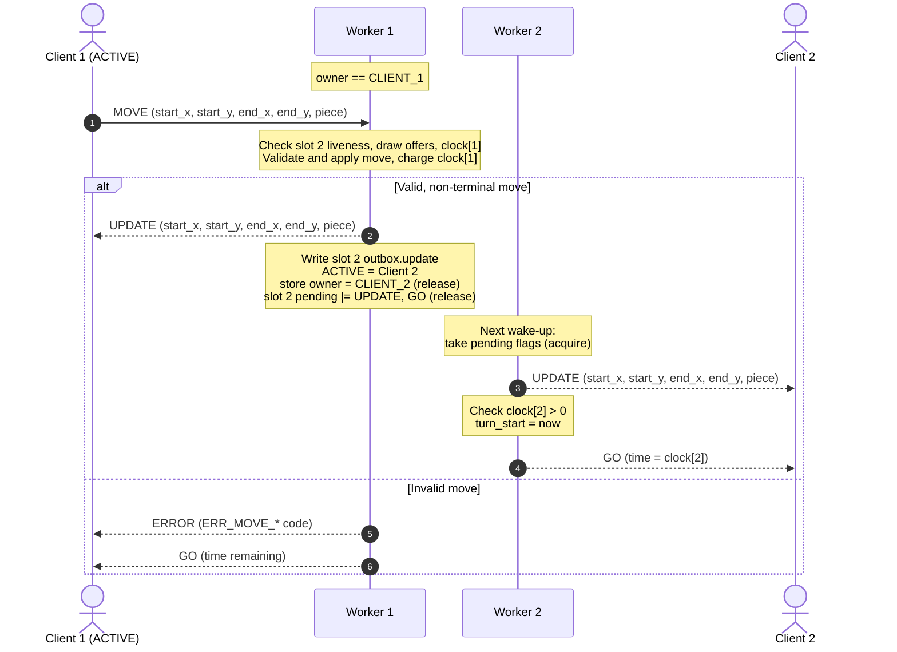

# Concurrency Design

## Server Concurrency Model

### Threads

A dedicated worker thread is spawned for each connected client connection socket.

The main thread will reject additional connections after both players have joined, so at most two client-handling threads and one main thread will ever be active at the same time.

The main thread accepts connections and drives the match lifecycle (`WAIT_P1`, `WAIT_P2`, `INIT`, `FINISH`, `CLEANUP`). It also refuses connections when both slots are taken (see Refused Connections). Each worker thread performs all socket I/O for its own client: it reads and frames incoming messages, sends outgoing messages, and handles keepalives.

### Shared State

Each thread will contain its own thread-local response mechanism for forbidding unaccepted actions by the clients.

The game can be in three states:

| Atomic state | Exclusive owner |                            Permitted operations                            |
|:------------:|:---------------:|:--------------------------------------------------------------------------:|
|    `MAIN`    |   Main thread   | Initialize, admit connections, handle lifecycle transitions, finalize game |
|  `CLIENT_1`  | Client 1 worker |             Validate and apply client 1's accepted game action             |
|  `CLIENT_2`  | Client 2 worker |             Validate and apply client 2's accepted game action             |

Each thread will keep a thread-local copy of its own value and compare the owning state to its own state before performing any operation on shared state.

Each thread will only be allowed to read from or write to any other shared game state when the owning state is set to that thread's owning value. Each thread is only allowed to change the owning state from its own owning value to another thread's owning value.

A worker hands ownership to the opponent's worker after a valid, non-terminal move. It hands ownership to `MAIN` after a winning or drawing move, when both players have offered a draw on the same turn, when either client has rejected the `START` layout, when its own client's clock runs out, or when either client has disconnected.

The ownership state is a C11 atomic (`_Atomic u8`, from `<stdatomic.h>`). It is always written with `atomic_store_explicit(&owner, value, memory_order_release)` and always read with `atomic_load_explicit(&owner, memory_order_acquire)`. A release store makes every write the old owner made to shared state visible to whichever thread later reads the new value with an acquire load. As a result, a thread that sees itself as the owner also sees the previous owner's changes to the shared game state.

This establishes an essential invariant for our program: only one thread (specified by the atomic ownership state) may access and modify the shared game state at a time. All threads may access the atomic ownership state at any time, but only the active thread may modify it.

If a client attempts to modify game state while not in control, the server will respond with an `ERROR` (`ERR_NOT_YOUR_TURN`).

Some state sits outside the ownership scheme, and each piece has its own rule about which threads may write it: each client's liveness state, each client's outbox (pending outgoing messages), the draw offers, the layout-rejection flag, and the join lock. All are described below.

```c
#include <stdatomic.h>

enum { MAIN, CLIENT_1, CLIENT_2 }; // Ownership values

enum { // Client liveness
	SLOT_EMPTY,     // No client assigned
	SLOT_CONNECTED, // TCP connection accepted, waiting for CONNECT
	SLOT_JOINED,    // CONNECT accepted, client is a player
	SLOT_DEAD       // Client disconnected, timed out, or failed
};

enum { // Pending outgoing messages, as bit flags, sent in this order
	PEND_START      = 1 << 0,
	PEND_UPDATE     = 1 << 1,
	PEND_GO         = 1 << 2,
	PEND_DRAW       = 1 << 3,
	PEND_END        = 1 << 4,
	PEND_DISCONNECT = 1 << 5
};

struct Outbox { // Payloads for pending messages
	struct Start start;   // Per client: its opponent's ID and its own colour. Only the first start_payload_size(count) bytes are sent
	struct Update update;
	struct End end;
};

struct Slot { // One per client
	int sock;              // Written by main before the worker starts, then used only by the worker
	u8 id[ID_MAX_SIZE];    // Written by the worker before it stores SLOT_JOINED
	_Atomic u8 liveness;   // SLOT_*
	_Atomic u8 pending;    // PEND_* flags
	struct Outbox outbox;
};

_Atomic u8 owner;     // MAIN, CLIENT_1, or CLIENT_2
struct Slot slots[2];
_Atomic u32 draw_state; // Turn number << 2 | bit i set once client i has offered on that turn
_Atomic u8 config_tie;  // Set when a client rejects the START layout
atomic_flag join_lock;  // Serializes the duplicate-ID check with joining

// Shared game state, accessed only by the owner
struct Game game;
unsigned clock[2];          // Remaining seconds per client
struct timespec turn_start; // CLOCK_MONOTONIC time the ACTIVE client's GO was sent
```

### Client Liveness

Each client slot has an atomic liveness state, so any thread can check whether a client is still connected without owning the game state.

| Transition                     | Written by    | When |
|:-------------------------------|:-------------:|:-----|
| `SLOT_EMPTY` -> `SLOT_CONNECTED` | Main thread   | After accepting a TCP connection, before starting the worker |
| `SLOT_CONNECTED` -> `SLOT_JOINED` | Worker        | After receiving a valid `CONNECT` and sending `ACCEPT` |
| any -> `SLOT_DEAD`               | Worker        | On `DISCONNECT`, keepalive timeout, `EOF`, TCP error, or a fatal error (unknown message type) from its client |
| `SLOT_DEAD` -> `SLOT_EMPTY`      | Main thread   | After the worker has exited and been joined with `pthread_join` |

While its worker is running, only that worker writes a slot's liveness. The main thread writes it only before the worker starts and after the worker has been joined, so the two never write it at the same time. Liveness is stored with `memory_order_release` and loaded with `memory_order_acquire`. As a result, a thread that sees `SLOT_JOINED` also sees the player ID that the worker wrote before it.

A `SLOT_CONNECTED` worker validates each `CONNECT` itself. An ID that fails `player_id_valid()` (empty, no NUL terminator, or not printable ASCII) gets `ERR_BAD_PLAYER_ID`. Otherwise the worker takes `join_lock` (a spin on `atomic_flag_test_and_set_explicit`, released with `atomic_flag_clear_explicit`) and compares the ID with the other slot's, if that slot is `SLOT_JOINED`. A match gets `ERR_DUPLICATE_PLAYER_ID`. Otherwise the worker writes the ID, stores `SLOT_JOINED`, and releases the lock before sending `ACCEPT`. The lock ensures that two clients sending the same ID at the same moment can't both join. After either error the slot stays `SLOT_CONNECTED`, so the client can retry until its keepalive timeout marks it dead.

The main thread admits a new connection into the first `SLOT_EMPTY` slot. When neither slot is empty, it refuses the connection (see Refused Connections). It goes from waiting to `INIT` only once both slots are `SLOT_JOINED`. If a slot becomes `SLOT_DEAD` while waiting, the main thread tells that worker to exit (`PEND_DISCONNECT`), joins it, and resets the slot to `SLOT_EMPTY`.

### Single-Writer Rule

**Each client socket is written only by that client's worker thread.** No other thread ever calls `send()` on it. The one socket without a worker, a refused connection, is written only by the main thread. As a result, outgoing messages can never interleave on the wire, even when `send()` writes only part of a message and has to be called again.

Other threads deliver messages to a client through that client's outbox:

1. The sending thread writes the message payload into `slots[i].outbox`.
2. It sets the message's flag with `atomic_fetch_or_explicit(&slots[i].pending, PEND_*, memory_order_release)`.
3. The worker takes all pending flags at once with `atomic_exchange_explicit(&slots[i].pending, 0, memory_order_acquire)`. It then sends the flagged messages in a fixed order: `START`, `UPDATE`, `GO`, `DRAW`, `END`, `DISCONNECT`.

The release/acquire pair guarantees that the worker sees the payload written in step 1. `PEND_DRAW` has no outbox payload: when the worker sends it, it reads `draw_state` and sends `DRAW` with that turn only if the opponent's offer bit is still set. Otherwise the offer lapsed while queued, and the worker drops it. A sender writes an outbox field only when the matching flag is clear. Strict turn alternation guarantees this: a worker's previous `UPDATE` has always been sent before its client receives the `GO` that allows the next move.

| Message      | Sent to client `i` by | Delivered |
|:-------------|:----------------------|:----------|
| `KEEPALIVE`  | Worker `i`            | Directly, on its own timer |
| `ACCEPT`     | Worker `i`            | Directly, after a valid `CONNECT` |
| `ERROR`      | Worker `i`            | Directly (including `ERR_BAD_PLAYER_ID`, `ERR_DUPLICATE_PLAYER_ID` and the fatal `ERR_UNKNOWN_TYPE`) |
| `UPDATE` (own move)  | Worker `i`    | Directly, after its client's move is accepted |
| `GO` (retry) | Worker `i`            | Directly, after an invalid move |
| `START`      | Main thread           | Through the outbox (`PEND_START`) |
| `UPDATE` (opponent's move) | Opponent's worker | Through the outbox (`PEND_UPDATE`) |
| `GO` (new turn) | Main thread or opponent's worker | Through the outbox (`PEND_GO`); worker `i` fills in the time when it sends it |
| `DRAW` (offer) | Opponent's worker  | Through the outbox (`PEND_DRAW`) |
| `END`        | Main thread           | Through the outbox (`PEND_END`) |
| `DISCONNECT` | Main thread           | Through the outbox (`PEND_DISCONNECT`); the worker then closes the socket and exits |
| `DISCONNECT` (after `ERR_UNKNOWN_TYPE`) | Worker `i` | Directly; the worker then closes the socket and marks the slot dead |

### Signals

The server process ignores `SIGPIPE`, so writing to a closed socket returns an error (`EPIPE`) instead of killing the process. Every worker thread blocks `SIGINT` with `pthread_sigmask` before it starts, so only the main thread receives it. The main thread's `SIGINT` handler only sets a flag (`volatile sig_atomic_t exit_requested`). Nothing else happens until `CLEANUP`, where the main thread exits if the flag is set. Ctrl-C therefore never interrupts a game. Any other way of stopping the server is left to the clients' keepalive timeouts.

### Refused Connections

When both slots are taken, the main thread accepts the extra connection, sends `ERROR` (`ERR_SERVER_FULL`) and `DISCONNECT` with non-blocking sends, and closes the socket. It handles one refused connection at a time, so at most three sockets are open: two players and the one being refused. Beyond that, the server may close further connections without sending anything, or leave them in the listen backlog. If a send would block, the main thread closes the socket anyway rather than wait.

### Draw Offers

A draw offer can arrive from either client at any time, including from the inactive player, whose worker doesn't own the game state. An offer stands only for the turn it names. The current turn number and both offers are therefore kept outside the ownership scheme, packed into one atomic word, `draw_state` = turn << 2 | offer bits (bit `i` for client `i`), so that a turn and its offers always change together:

- The main thread stores turn 0 with no offers in `INIT`, before handing ownership to the first `ACTIVE` worker.
- A worker handles `DRAW` only between sending its client `START` and sending `END`. It tracks this with a thread-local flag, since each match has its own workers. Outside that window it ignores `DRAW`.
- On `DRAW` for turn `t`, worker `i` updates `draw_state` with a compare-and-swap loop (`atomic_compare_exchange_weak_explicit`, `memory_order_acq_rel`):
	- If the word's turn isn't `t` (modulo 65,536), the offer is for another turn, and the worker drops it.
	- If bit `i` is already set, the offer already stands, and the worker does nothing more.
	- Otherwise it sets bit `i`. If the opponent's bit wasn't set, it forwards the offer by setting `PEND_DRAW` on the opponent's slot.
	- If the opponent's bit was set, both players have now offered. The worker doesn't forward anything. If it owns the game state, it records a tie and hands ownership to `MAIN`. Otherwise the owning worker sees both bits at its next wake-up (step 2 of the worker loop) and does so.
- After a valid, non-terminal move, the owning worker stores the next turn with no offers, before handing ownership on. A `DRAW` for the old turn now fails the turn check. An acceptance that completes a pair while the move is being handled is overwritten: the move wins.

### Layout Rejection

A client that rejects the `START` layout sends a Configuration-family `ERROR` and then `DISCONNECT`, and the game must end tied rather than as a forfeit. Its worker may not own the game state, so it sets `config_tie` (release) before handling the `DISCONNECT` that follows, and therefore before storing `SLOT_DEAD`. If it owns the game state, it records the tie and hands ownership to `MAIN` itself. Otherwise the owning worker sees the flag at step 2 of its loop. Because the flag is set before the slot is marked dead, a worker that sees `SLOT_DEAD` with an acquire load also sees the flag, and records a tie instead of a win. A worker handles a Configuration `ERROR` only in the same window as `DRAW`. Any other `ERROR` is ignored.

### Clocks

The clocks are part of the game state, so only the owner reads or writes them. The `ACTIVE` client's worker owns the game state for its whole turn, from before its `GO` is queued until it hands ownership on, so that worker runs its own client's clock:

- **Starting the turn:** when the worker sends a new-turn `GO` (`PEND_GO`), it first checks its client's clock. If the clock is zero, it records the opponent as the winner and hands ownership to `MAIN` without sending `GO`, so a `GO` never carries zero. Otherwise it sends `GO` with `clock[i]` and stores the current `CLOCK_MONOTONIC` time in `turn_start`.
- **During the turn:** at every wake-up (step 2 of the worker loop), if the time elapsed since `turn_start` has reached `clock[i]`, the client has run out of time. The worker records the opponent as the winner and hands ownership to `MAIN`.
- **Retry `GO`:** after an invalid move, the clock keeps running. The retry `GO` carries `clock[i]` minus the whole seconds elapsed so far, which is always at least 1, because the client would already have timed out otherwise.
- **Ending the turn:** after a valid move, the worker subtracts the whole seconds elapsed since `turn_start`, or 1 if less than a second has passed, before handing ownership on.

### Worker Loop

Each worker waits on its socket with `poll()` and a short timeout (`POLL_MS`, 50 ms). The worker must also notice outbox flags and ownership changes, which `poll()` can't wake it for, so the timeout is kept short. On every wake-up it does the following, in order:

1. **Flush the outbox.** It takes the pending flags and sends the flagged messages in order. If `PEND_DISCONNECT` was set, it sends `DISCONNECT` (unless its client is dead), closes the socket, and exits the thread.
2. **Check for the end of the game.** If the worker owns the game state, it checks, in order:
	- the layout rejection: if `config_tie` is set, it records a tie and hands ownership to `MAIN`;
	- the opponent's liveness: if the slot is `SLOT_DEAD`, it reads `config_tie` again, then records a tie if it's set, or its own client as the winner otherwise, and hands ownership to `MAIN`;
	- the draw offers: if both bits of `draw_state` are set, it records a tie and hands ownership to `MAIN`;
	- its own client's clock: if it has run out, it records the opponent as the winner and hands ownership to `MAIN`.

	These checks come before reading messages, so if a move arrives at the same moment as a layout rejection, the opponent's disconnect, a draw acceptance, or the end of the clock, the move is not applied.
3. **Read messages.** It reads and handles any complete messages according to the server FSM:
	- A `KEEPALIVE` resets the client's keepalive timer.
	- A `MOVE` is classified only if the worker owns the game state; otherwise it gets an `ERROR` (`ERR_NOT_YOUR_TURN`). An invalid move gets the matching Move-family code.
	- A `CONNECT` is validated as described under Client Liveness.
	- A `DRAW` is handled as described under Draw Offers.
	- A Configuration-family `ERROR` is handled as described under Layout Rejection. Any other `ERROR` is ignored.
	- A message with an unknown type gets `ERROR` (`ERR_UNKNOWN_TYPE`) and `DISCONNECT`; the worker then closes the socket and marks the client dead.
	- A `DISCONNECT`, `EOF`, or TCP error marks the client dead (see below).
4. **Handle keepalives.** If `KEEPALIVE_INTERVAL_MS` has passed since it last sent one, it sends a `KEEPALIVE`. If nothing has arrived from the client for `KEEPALIVE_TIMEOUT_MS`, or a partial message hasn't completed within `MESSAGE_TIMEOUT_MS` of its first byte, it marks the client dead.

All four intervals are defined in `shared/timing.h`:

| Constant | Value |
|:---------|:-----:|
| `KEEPALIVE_INTERVAL_MS` | 1,000 ms |
| `KEEPALIVE_TIMEOUT_MS` | 60,000 ms |
| `MESSAGE_TIMEOUT_MS` | 10,000 ms |
| `POLL_MS` | 50 ms |

When a worker handles a valid, non-terminal move, it:

1. applies the move to the game state, charges its client's clock (see Clocks), and stores the next turn with no offers into `draw_state`,
2. sends `UPDATE` to its own client,
3. writes the move into the opponent's `outbox.update`,
4. sets `ACTIVE` to the opponent,
5. stores the opponent's value into `owner`, and
6. sets `PEND_UPDATE | PEND_GO` on the opponent's slot.

Ownership is handed over before `GO` is queued. Once the opponent's client receives `GO` and replies with `MOVE`, its worker is therefore guaranteed to already own the game state.

For a winning or drawing move, the worker sends `UPDATE` to its own client, queues `PEND_UPDATE` for the opponent, records the result, and hands ownership to `MAIN`. The main thread then queues `PEND_END` for both clients, and the opponent's worker sends `UPDATE` before `END` because of the fixed send order.

### Disconnects & Forfeits

When a worker's client disconnects, times out, or fails, the worker stores `SLOT_DEAD` into its own slot and stops all socket I/O. Then:

- **If it owns the game state**, it records the opponent as the winner and hands ownership to `MAIN` itself.
- **If it does not own the game state**, it changes nothing else. The owning worker sees `SLOT_DEAD` within one `POLL_MS`, at step 2 of its loop, and hands ownership to `MAIN` with itself as the winner. Because clients send keepalives on every tick, the owning worker never waits long for the next wake-up.

A dead worker does not exit on its own. It keeps running its loop without socket I/O until the main thread sets `PEND_DISCONNECT`. If ownership is handed to it while its client is dead (for example, the opponent made a move just as this client dropped), it immediately records the opponent as the winner (or a tie, if `config_tie` is set) and hands ownership to `MAIN`. This guarantees that ownership is never handed to a thread that has exited, which would leave no thread able to continue the game.

While the main thread owns the game state (`WAIT_P2`, `INIT`, `FINISH`, `CLEANUP`), it checks both slots' liveness itself. In `FINISH`, it queues `END` only for clients that are not `SLOT_DEAD`. In `CLEANUP`, it queues `PEND_DISCONNECT` for both workers, joins them, and resets both slots to `SLOT_EMPTY`.

### Client State & Turn Synchronization Scheme

Message flow when Player 1 makes a valid, non-terminal move:



### Board Synchronization

Each client keeps a full local copy of the board. The server sends the whole board only once, as the starting layout in `START`. After that, every accepted move is sent as an `UPDATE` to both clients, in the order the server accepted them, so both local boards stay identical to the server's. At the end of the game, `END` tells each client whether it won (`1`), lost (`-1`), or tied (`0`), and its material points from the server's game state.
