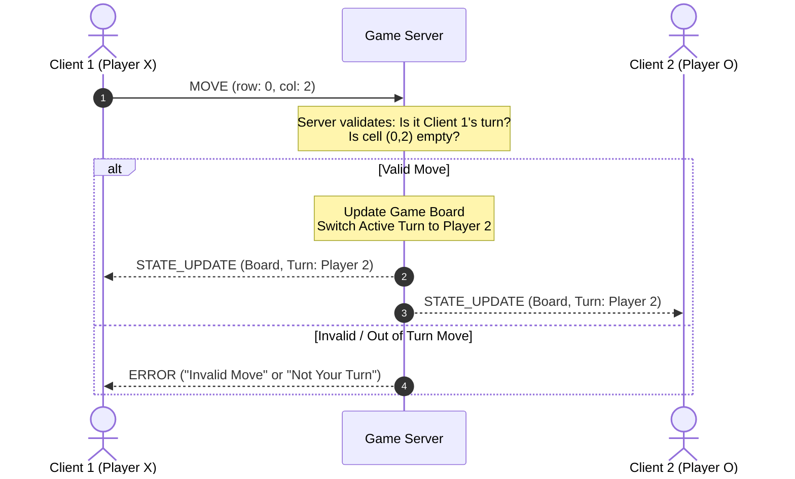

# Concurrency Design

## Server Concurrency Model

### Threads

A dedicated worker thread is spawned for each connected client connection socket, as there are no pre-built selectors in C.

The main thread will reject additional connections after both players have joined, so at most two client-handling threads and one main thread will ever be active at the same time.

### Shared State

Each thread will contain its own thread-local response mechanism for forbidding unaccepted actions by the clients.

The game can be in three states:

| Atomic state | Exclusive owner |                            Permitted operations                            |
|:------------:|:---------------:|:--------------------------------------------------------------------------:|
|    `MAIN`    |   Main thread   | Initialize, admit connections, handle lifecycle transitions, finalize game |
|  `CLIENT_1`  | Client 1 worker |             Validate and apply client 1's accepted game action             |
|  `CLIENT_2`  | Client 2 worker |             Validate and apply client 2's accepted game action             |

Each thread will keep a thread-local copy of its own value and compare the owning state to its own state before performing any operation on shared state.

Each thread will only be allowed to read from or write to any other shared game state when the owning state is set to that thread's owning value. Each thread is only allowed to change the owning state from its own owning value to another thread's owning value.

The atomic ownershop state will always be stored into with `ATOMIC_RELEASE` and read from with `ATOMIC_ACQUIRE`, ensuring that changes in memory are reflected across threads.

This establishes an essential invariant for our program: only one thread (specified by the atomic ownership state) may access and modify the shared game state at a time. All threads may access the atomic ownership state at any time, but only the active thread may modify it.

If a client attemts to modify game state while not in control, the server will respond with an error code.

Shared memory structures (game state, board grid, client socket list) are protected using threading.Lock to prevent race conditions during state mutation.

### Client State & Turn Synchronization Scheme

Architect the message flow sequence when Player 1 makes a move:

