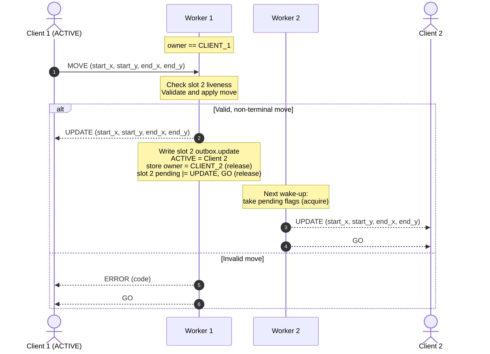

# Concurrency Design

## Server Concurrency Model

### Threads

A dedicated worker thread is spawned for each connected client connection socket.

The main thread will reject additional connections after both players have joined, so at most two client-handling threads and one main thread will ever be active at the same time.

The main thread accepts connections and drives the match lifecycle (`WAIT_P1`, `WAIT_P2`, `INIT`, `FINISH`, `CLEANUP`). Each worker thread performs all socket I/O for its own client: it reads and frames incoming messages, sends outgoing messages, and handles keepalives.

### Shared State

Each thread will contain its own thread-local response mechanism for forbidding unaccepted actions by the clients.

The game can be in three states:

| Atomic state | Exclusive owner |                            Permitted operations                            |
|:------------:|:---------------:|:--------------------------------------------------------------------------:|
|    `MAIN`    |   Main thread   | Initialize, admit connections, handle lifecycle transitions, finalize game |
|  `CLIENT_1`  | Client 1 worker |             Validate and apply client 1's accepted game action             |
|  `CLIENT_2`  | Client 2 worker |             Validate and apply client 2's accepted game action             |

Each thread will keep a thread-local copy of its own value and compare the owning state to its own state before performing any operation on shared state.

Each thread will only be allowed to read from or write to any other shared game state when the owning state is set to that thread's owning value. Each thread is only allowed to change the owning state from its own owning value to another thread's owning value.

A worker hands ownership to the opponent's worker after a valid, non-terminal move. It hands ownership to `MAIN` after a winning or drawing move, or when either client has disconnected.

The ownership state is a C11 atomic (`_Atomic u8`, from `<stdatomic.h>`). It is always written with `atomic_store_explicit(&owner, value, memory_order_release)` and always read with `atomic_load_explicit(&owner, memory_order_acquire)`. A release store makes every write the old owner made to shared state visible to whichever thread later reads the new value with an acquire load. As a result, a thread that sees itself as the owner also sees the previous owner's changes to the shared game state.

This establishes an essential invariant for our program: only one thread (specified by the atomic ownership state) may access and modify the shared game state at a time. All threads may access the atomic ownership state at any time, but only the active thread may modify it.

If a client attempts to modify game state while not in control, the server will respond with an error code.

Two other kinds of per-client state sit outside the ownership scheme, and each has its own rule about which threads may write it: the client's liveness state and its outbox (pending outgoing messages). Both are described below.

```c
#include <stdatomic.h>

enum { MAIN, CLIENT_1, CLIENT_2 }; // Ownership values

enum { // Client liveness
	SLOT_EMPTY,     // No client assigned
	SLOT_CONNECTED, // TCP connection accepted, waiting for CONNECT
	SLOT_JOINED,    // CONNECT accepted, client is a player
	SLOT_DEAD       // Client disconnected, timed out, or failed
};

enum { // Pending outgoing messages, as bit flags, sent in this order
	PEND_START      = 1 << 0,
	PEND_UPDATE     = 1 << 1,
	PEND_GO         = 1 << 2,
	PEND_END        = 1 << 3,
	PEND_DISCONNECT = 1 << 4
};

struct Outbox { // Payloads for pending messages
	struct Start start;
	struct Update update;
	struct End end;
};

struct Slot { // One per client
	int sock;              // Written by main before the worker starts, then used only by the worker
	u8 id[ID_MAX_SIZE];    // Written by the worker before it stores SLOT_JOINED
	_Atomic u8 liveness;   // SLOT_*
	_Atomic u8 pending;    // PEND_* flags
	struct Outbox outbox;
};

_Atomic u8 owner;     // MAIN, CLIENT_1, or CLIENT_2
struct Slot slots[2];
struct Game game;     // Shared game state, accessed only by the owner
```

### Client Liveness

Each client slot has an atomic liveness state, so any thread can check whether a client is still connected without owning the game state.

| Transition                     | Written by    | When |
|:-------------------------------|:-------------:|:-----|
| `SLOT_EMPTY` -> `SLOT_CONNECTED` | Main thread   | After accepting a TCP connection, before starting the worker |
| `SLOT_CONNECTED` -> `SLOT_JOINED` | Worker        | After receiving a valid `CONNECT` and sending `ACCEPT` |
| any -> `SLOT_DEAD`               | Worker        | On `DISCONNECT`, keepalive timeout, `EOF`, or TCP error from its client |
| `SLOT_DEAD` -> `SLOT_EMPTY`      | Main thread   | After the worker has exited and been joined with `pthread_join` |

While its worker is running, only that worker writes a slot's liveness. The main thread writes it only before the worker starts and after the worker has been joined, so the two never write it at the same time. Liveness is stored with `memory_order_release` and loaded with `memory_order_acquire`. As a result, a thread that sees `SLOT_JOINED` also sees the player ID that the worker wrote before it.

The main thread admits a new connection into the first `SLOT_EMPTY` slot and rejects connections when neither slot is empty. It goes from waiting to `INIT` only once both slots are `SLOT_JOINED`. If a slot becomes `SLOT_DEAD` while waiting, the main thread tells that worker to exit (`PEND_DISCONNECT`), joins it, and resets the slot to `SLOT_EMPTY`.

### Single-Writer Rule

**Each client socket is written only by that client's worker thread.** No other thread ever calls `send()` on it. As a result, outgoing messages can never interleave on the wire, even when `send()` writes only part of a message and has to be called again.

Other threads deliver messages to a client through that client's outbox:

1. The sending thread writes the message payload into `slots[i].outbox`.
2. It sets the message's flag with `atomic_fetch_or_explicit(&slots[i].pending, PEND_*, memory_order_release)`.
3. The worker takes all pending flags at once with `atomic_exchange_explicit(&slots[i].pending, 0, memory_order_acquire)`. It then sends the flagged messages in a fixed order: `START`, `UPDATE`, `GO`, `END`, `DISCONNECT`.

The release/acquire pair guarantees that the worker sees the payload written in step 1. A sender writes an outbox field only when the matching flag is clear. Strict turn alternation guarantees this: a worker's previous `UPDATE` has always been sent before its client receives the `GO` that allows the next move.

| Message      | Sent to client `i` by | Delivered |
|:-------------|:----------------------|:----------|
| `KEEPALIVE`  | Worker `i`            | Directly, on its own timer |
| `ACCEPT`     | Worker `i`            | Directly, after a valid `CONNECT` |
| `ERROR`      | Worker `i`            | Directly |
| `UPDATE` (own move)  | Worker `i`    | Directly, after its client's move is accepted |
| `GO` (retry) | Worker `i`            | Directly, after an invalid move |
| `START`      | Main thread           | Through the outbox (`PEND_START`) |
| `UPDATE` (opponent's move) | Opponent's worker | Through the outbox (`PEND_UPDATE`) |
| `GO` (new turn) | Main thread or opponent's worker | Through the outbox (`PEND_GO`) |
| `END`        | Main thread           | Through the outbox (`PEND_END`) |
| `DISCONNECT` | Main thread           | Through the outbox (`PEND_DISCONNECT`); the worker then closes the socket and exits |

### Worker Loop

Each worker waits on its socket with `poll()` and a short timeout (`POLL_MS`, for example 50 ms). The worker must also notice outbox flags and ownership changes, which `poll()` can't wake it for, so the timeout is kept short. On every wake-up it does the following, in order:

1. **Flush the outbox.** It takes the pending flags and sends the flagged messages in order. If `PEND_DISCONNECT` was set, it sends `DISCONNECT` (unless its client is dead), closes the socket, and exits the thread.
2. **Check the opponent's liveness.** If the worker owns the game state and the opponent's slot is `SLOT_DEAD`, it records its own client as the winner and hands ownership to `MAIN`. This check comes before reading messages, so if a move and the opponent's disconnect arrive at the same moment, the disconnect is handled first.
3. **Read messages.** It reads and handles any complete messages according to the server FSM:
	- A `KEEPALIVE` resets the client's keepalive timer.
	- A `MOVE` is classified only if the worker owns the game state; otherwise it gets an `ERROR`.
	- A `DISCONNECT`, `EOF`, or TCP error marks the client dead (see below).
4. **Handle keepalives.** If `KEEPALIVE_MS` has passed since it last sent one, it sends a `KEEPALIVE`. If nothing has arrived from the client for `KEEPALIVE_TIMEOUT_MS`, it marks the client dead.

When a worker handles a valid, non-terminal move, it:

1. applies the move to the game state,
2. sends `UPDATE` to its own client,
3. writes the move into the opponent's `outbox.update`,
4. sets `ACTIVE` to the opponent,
5. stores the opponent's value into `owner`, and
6. sets `PEND_UPDATE | PEND_GO` on the opponent's slot.

Ownership is handed over before `GO` is queued. Once the opponent's client receives `GO` and replies with `MOVE`, its worker is therefore guaranteed to already own the game state.

For a winning or drawing move, the worker sends `UPDATE` to its own client, queues `PEND_UPDATE` for the opponent, records the result, and hands ownership to `MAIN`. The main thread then queues `PEND_END` for both clients, and the opponent's worker sends `UPDATE` before `END` because of the fixed send order.

### Disconnects & Forfeits

When a worker's client disconnects, times out, or fails, the worker stores `SLOT_DEAD` into its own slot and stops all socket I/O. Then:

- **If it owns the game state**, it records the opponent as the winner and hands ownership to `MAIN` itself.
- **If it does not own the game state**, it changes nothing else. The owning worker sees `SLOT_DEAD` within one `POLL_MS`, at step 2 of its loop, and hands ownership to `MAIN` with itself as the winner. Because clients send keepalives on every tick, the owning worker never waits long for the next wake-up.

A dead worker does not exit on its own. It keeps running its loop without socket I/O until the main thread sets `PEND_DISCONNECT`. If ownership is handed to it while its client is dead (for example, the opponent made a move just as this client dropped), it immediately records the opponent as the winner and hands ownership to `MAIN`. This guarantees that ownership is never handed to a thread that has exited, which would leave no thread able to continue the game.

While the main thread owns the game state (`WAIT_P2`, `INIT`, `FINISH`, `CLEANUP`), it checks both slots' liveness itself. In `FINISH`, it queues `END` only for clients that are not `SLOT_DEAD`. In `CLEANUP`, it queues `PEND_DISCONNECT` for both workers, joins them, and resets both slots to `SLOT_EMPTY`.

### Client State & Turn Synchronization Scheme

Message flow when Player 1 makes a valid, non-terminal move:



### Board Synchronization

Each client keeps a full local copy of the board, and the server never sends the whole board. Every accepted move is sent as an `UPDATE` to both clients, in the order the server accepted them, so both local boards stay identical to the server's. At the end of the game, `END` tells each client whether it won (`1`), lost (`-1`), or tied (`0`).
