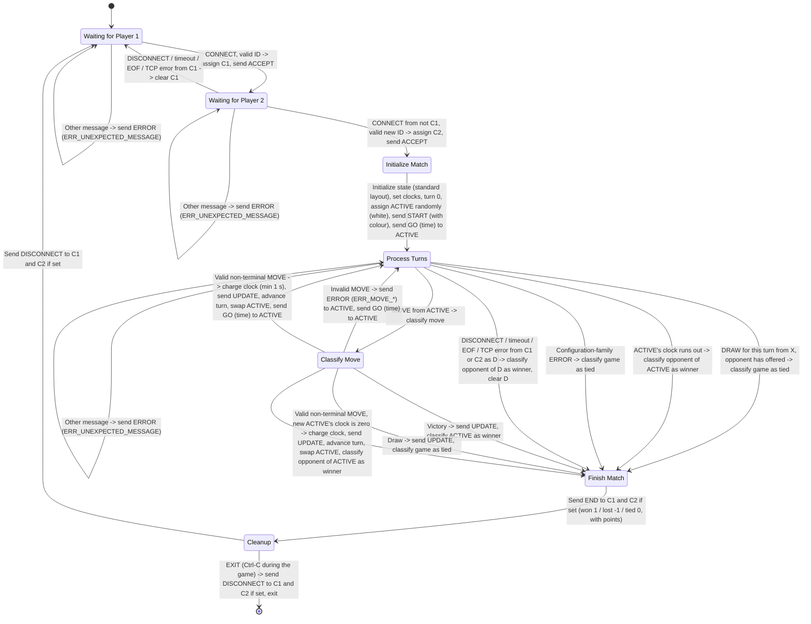
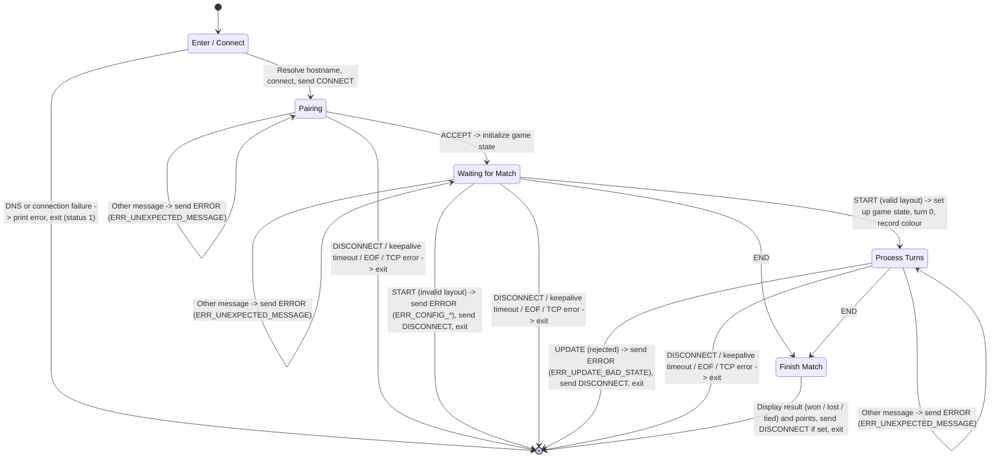

# Game State Machine (FSM) Design

## 2.3 Game Finite State Machine (FSM) Design

### Error Handling

Every `ERROR` carries a code from the families defined in `protocol_blueprint.md` (Error Codes). "Other message" transitions send `ERR_UNEXPECTED_MESSAGE`, a `MOVE` from the inactive player gets `ERR_NOT_YOUR_TURN`, and an invalid move gets the matching Move-family code (`ERR_MOVE_*`).

`DRAW` may be sent at any time, so it is never an "other message": states that don't act on it ignore it.

A peer must never respond to an `ERROR` with an `ERROR`. A received `ERROR` is reported to the user (client) or ignored (server), and never triggers an "other message" response. This prevents two peers from exchanging `ERROR` messages indefinitely. The one exception on the server is a Configuration-family `ERROR` during `TURN`, which ties the game.

Some errors are fatal (see `protocol_blueprint.md`, Fatal Errors). The peer that detects one sends `ERROR`, then `DISCONNECT`, and closes the connection:
- `ERR_UNKNOWN_TYPE`, by either side, in any state
- a Configuration-family code, by a client that receives an invalid `START`
- `ERR_UPDATE_BAD_STATE`, by a client whose engine rejects an `UPDATE`

### Server-Side

The server FSM describes the server's behavior as a whole. `concurrency_design.md` describes which thread performs each step. In particular, each client's worker thread sends all messages to its client, including keepalives, and detects that client's disconnects and timeouts.

A connection that has been accepted but hasn't yet joined with a valid `CONNECT` is *unassigned*. It has its own keepalive timer, which any message from it resets.

"Tick" is every `KEEPALIVE_INTERVAL_MS` (one second), and a "keepalive timeout" is `KEEPALIVE_TIMEOUT_MS` (one minute) without any message from that peer. Both are defined in `shared/timing.h`.

The server ignores Ctrl-C (`SIGINT`) except to set `EXIT`, which takes effect only at `CLEANUP`, after the current game completes.

Text

In every state:
- on a new connection while both player slots are taken:
	- send `ERROR` (`ERR_SERVER_FULL`) and `DISCONNECT` to it, and close it
	- beyond three simultaneous connections, the server may instead drop it without a message
- on a message with an unknown type from any connection `U`:
	- send `ERROR` (`ERR_UNKNOWN_TYPE`) and `DISCONNECT` to `U`, and close it
	- handle it as a disconnect from `U` (below)
- on keepalive timeout, `EOF` or TCP error from an unassigned connection:
	- close it

`WAIT_P1`:
- on `CONNECT` with a valid ID:
	- assign client to `C1`
	- respond `ACCEPT`
	- go to `WAIT_P2`
- on `CONNECT` with an invalid ID (empty, no NUL terminator, or a byte outside printable ASCII `0x20`–`0x7E` before it):
	- send `ERROR` (`ERR_BAD_PLAYER_ID`)
	- keep the connection open, so the client can retry
- on `KEEPALIVE` from an unassigned connection:
	- reset its keepalive timer
- on `ERROR` OR
- on `DRAW`:
	- ignore
- on other message:
	- send `ERROR` (`ERR_UNEXPECTED_MESSAGE`)

`WAIT_P2`:
- on tick:
	- send `KEEPALIVE` to `C1`
- on `CONNECT` from not `C1` with a valid ID that differs from `C1`'s:
	- assign client to `C2`
	- respond `ACCEPT`
	- go to `INIT`
- on `CONNECT` from not `C1` with an invalid ID:
	- send `ERROR` (`ERR_BAD_PLAYER_ID`)
	- keep the connection open, so the client can retry
- on `CONNECT` from not `C1` with `C1`'s ID:
	- send `ERROR` (`ERR_DUPLICATE_PLAYER_ID`)
	- keep the connection open, so the client can retry
- on `KEEPALIVE` from `C1` or an unassigned connection:
	- reset its keepalive timer
- on `ERROR` OR
- on `DRAW`:
	- ignore
- on other message:
	- send `ERROR` (`ERR_UNEXPECTED_MESSAGE`)
- on `DISCONNECT` from `C1` OR
- on keepalive timeout from `C1` OR
- on `EOF` from `C1` OR
- on TCP error from `C1`:
	- clear `C1`
	- go to `WAIT_P1`

`INIT`:
- initialize game state with the standard layout
- set both clocks to `CLOCK_DEFAULT_SECONDS` (ten minutes)
- set the turn number to 0, with no draw offers
- assign `ACTIVE` to `C1` or `C2` at random; `ACTIVE` plays white and the other player black
- send `START` to `C1` and `C2`, each with its opponent's ID, its own colour, and the layout
- send `GO` to `ACTIVE` with its remaining time, and start its clock
- go to `TURN`

`TURN`:
- on tick:
	- send `KEEPALIVE` to `C1` and `C2`
- on `MOVE` from `ACTIVE`:
	- go to `CLASSIFY`
- on `MOVE` from not `ACTIVE`:
	- send `ERROR` (`ERR_NOT_YOUR_TURN`)
- on `KEEPALIVE` from `C1` or `C2`:
	- reset that client's keepalive timer
- on `DRAW` for any turn but the current one:
	- ignore
- on `DRAW` for the current turn from `C1` or `C2` as `X`, if the opponent of `X` has offered on this turn:
	- classify game as tied
	- go to `FINISH`
- on `DRAW` for the current turn from `C1` or `C2` as `X`, if neither has offered on this turn:
	- record `X`'s offer
	- send `DRAW` (same turn) to the opponent of `X`
- on `DRAW` for the current turn from a client that has already offered on it:
	- ignore
- on `ACTIVE`'s clock running out:
	- classify opponent of `ACTIVE` as winner
	- go to `FINISH`
- on `ERROR` with a Configuration-family code from `C1` or `C2`:
	- classify game as tied (this takes precedence over the `DISCONNECT` that follows)
	- go to `FINISH`
- on any other `ERROR`:
	- ignore
- on other message:
	- send `ERROR` (`ERR_UNEXPECTED_MESSAGE`)
- on `DISCONNECT` from `C1` or `C2` as `D` OR
- on keepalive timeout from `C1` or `C2` as `D` OR
- on `EOF` from `C1` or `C2` as `D` OR
- on TCP error from `C1` or `C2` as `D`:
	- classify opponent of `D` as winner
	- clear `D`
	- go to `FINISH`

`CLASSIFY`:
- if invalid:
	- send `ERROR` to `ACTIVE` with the matching `ERR_MOVE_*` code
	- send `GO` to `ACTIVE` with its remaining time (its clock keeps running)
	- go to `TURN`
- if victory:
	- send `UPDATE` to `C1` and `C2`
	- classify `ACTIVE` as winner
	- go to `FINISH`
- if draw:
	- send `UPDATE` to `C1` and `C2`
	- classify game as tied
	- go to `FINISH`
- otherwise:
	- charge `ACTIVE`'s clock for the turn: the whole seconds elapsed since its `GO`, and at least one second
	- send `UPDATE` to `C1` and `C2`
	- advance the turn number, dropping any draw offers
	- swap `ACTIVE`
	- if `ACTIVE`'s clock is zero:
		- classify opponent of `ACTIVE` as winner
		- go to `FINISH`
	- otherwise:
		- send `GO` to `ACTIVE` with its remaining time, and start its clock
		- go to `TURN`

`FINISH`:
- send `END` to `C1` and `C2` if set, with `victory` from each receiver's perspective:
	- winner receives won (`1`), loser receives lost (`-1`)
	- on a tie, both receive tied (`0`)
- and with each receiver's material points
- go to `CLEANUP`

`CLEANUP`:
- send `DISCONNECT` to `C1` and `C2` if set
- if `EXIT` (Ctrl-C was pressed):
	- exit
- otherwise:
	- go to `WAIT_P1`

### Client-Side

Text

In every state but `ENTER` and `FINISH`:
- on a message with an unknown type:
	- send `ERROR` (`ERR_UNKNOWN_TYPE`) and `DISCONNECT` to server
	- exit
- on user `quit` or Ctrl-C (`SIGINT`):
	- send `DISCONNECT` to server (a forfeit during a game)
	- exit

`ENTER`:
- resolve the server's hostname; on failure, print the DNS error message and exit with status 1
- connect to the server; on failure, print an error message and exit with status 1
- send `CONNECT` to server
- go to `PAIR`

`PAIR`:
- on tick:
	- send `KEEPALIVE` to server
- on `ACCEPT`:
	- initialize game state
	- go to `WAIT`
- on `ERROR` (`ERR_BAD_PLAYER_ID` or `ERR_DUPLICATE_PLAYER_ID`) from server:
	- warn user and ask for another ID
	- send `CONNECT` to server with the new ID
	- go to `PAIR`
- on `KEEPALIVE` from server:
	- reset keepalive timer
- on any other `ERROR` from server:
	- warn user
- on `DRAW` from server:
	- ignore
- on other message:
	- send `ERROR` (`ERR_UNEXPECTED_MESSAGE`)
- on `DISCONNECT` from server OR
- on keepalive timeout from server OR
- on `EOF` from server OR
- on TCP error from server:
	- exit

`WAIT`:
- on tick:
	- send `KEEPALIVE` to server
- on `START` from server with a valid layout:
	- set up game state from the layout, at turn 0, and record its own colour
	- go to `TURN`
- on `START` from server with an invalid layout:
	- send `ERROR` to server (the matching `ERR_CONFIG_*` code)
	- send `DISCONNECT` to server
	- exit
- on `END` from server:
	- go to `FINISH`
- on `KEEPALIVE` from server:
	- reset keepalive timer
- on `ERROR` from server:
	- warn user
- on `DRAW` from server:
	- ignore
- on other message:
	- send `ERROR` to server (`ERR_UNEXPECTED_MESSAGE`)
- on `DISCONNECT` from server OR
- on keepalive timeout from server OR
- on `EOF` from server OR
- on TCP error from server:
	- exit

`TURN`:
- on tick:
	- send `KEEPALIVE` to server
- on `GO` from server with nonzero time:
	- show the remaining time from `GO`
	- prompt user for move
	- send `MOVE` to server
	- go to `TURN`
- on `GO` from server with zero time:
	- send `ERROR` to server (`ERR_ZERO_TIME`)
	- go to `TURN`
- on `DRAW` for the current turn from server:
	- tell the user the opponent offers a draw
	- go to `TURN`
- on `DRAW` for any other turn from server:
	- ignore
- on user draw request:
	- send `DRAW` to server with the current turn number (this doesn't use up the user's turn)
	- go to `TURN`
- on `ERROR` from server:
	- warn user
	- go to `TURN`
- on `UPDATE` that the local engine accepts:
	- update game state and advance the turn number
	- go to `TURN`
- on `UPDATE` that the local engine rejects:
	- send `ERROR` to server (`ERR_UPDATE_BAD_STATE`)
	- send `DISCONNECT` to server
	- exit
- on `END`:
	- go to `FINISH`
- on `KEEPALIVE` from server:
	- reset keepalive timer
- on other message:
	- send `ERROR` to server (`ERR_UNEXPECTED_MESSAGE`)
- on `DISCONNECT` from server OR
- on keepalive timeout from server OR
- on `EOF` from server OR
- on TCP error from server:
	- exit

`FINISH`:
- display result from `END` (won, lost, or tied) and the score summary (its material points)
- send `DISCONNECT` to server if set
- exit

### Disconnects

C exposes TCP exceptions through negative returns plus `errno`.

Graceful disconnects (`DISCONNECT` messages) and abrupt terminations (timeouts, EOF, and exceptions) are handled by the same disconnect logic in the FSM. Client-side disconnects from the server are treated as program failures, while server-side disconnects from a client are either treated as recoverable (while waiting for connections) or forfeits (during gameplay).

To handle exceptions and disconnects through `recv`, the read-loop must handle negative and zero lengths as connection terminations.